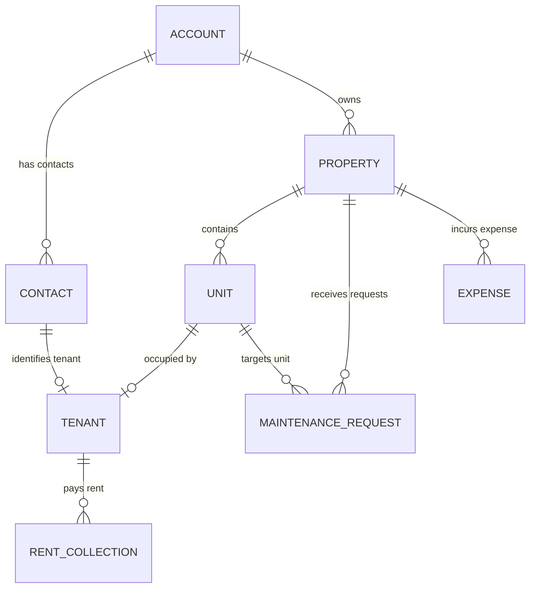
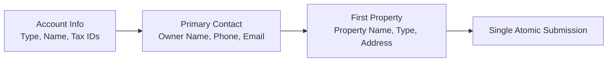
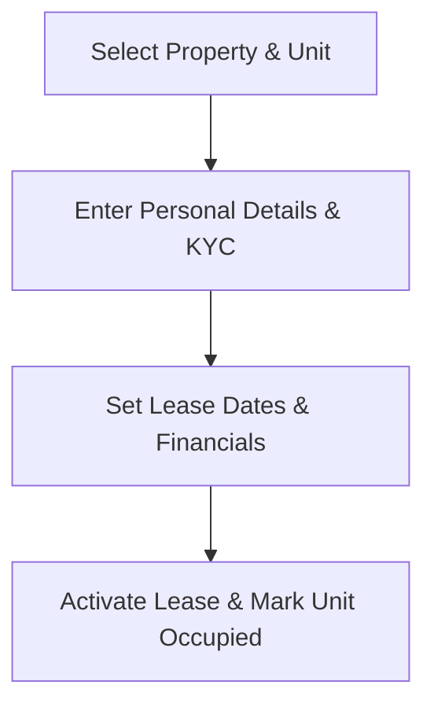
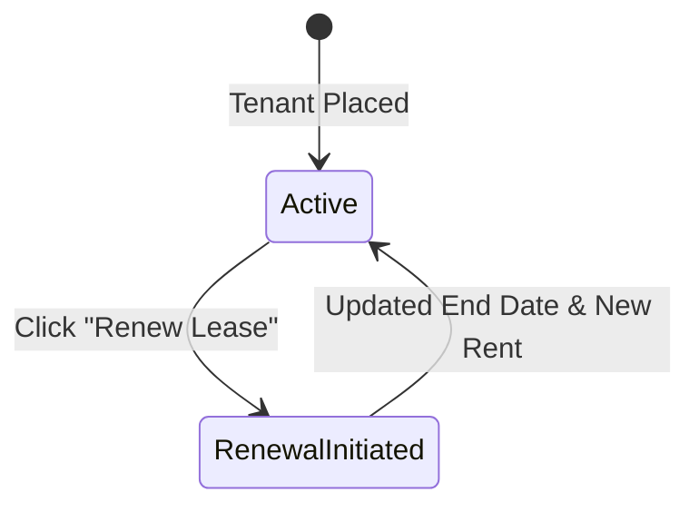
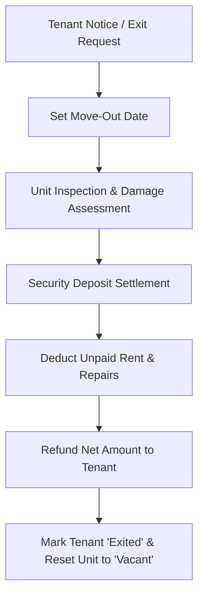
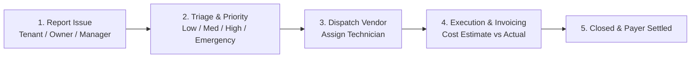

# 🏢 Property CRM — System Architecture & Feature Guide

A complete technical and operational guide detailing the core modules, workflows, feature definitions, and data lifecycles of the **Property CRM platform**.

---

## 📌 Table of Contents
1. [Platform Architecture & Data Relationships](#1-platform-architecture--data-relationships)
2. [Executive Dashboard](#2-executive-dashboard)
3. [Account Management (Individual & Company)](#3-account-management-individual--company)
   - [Unified 3-in-1 Creation Flow](#unified-3-in-1-creation-flow)
4. [Contacts Management](#4-contacts-management)
5. [Properties Management](#5-properties-management)
6. [Units Inventory](#6-units-inventory)
7. [Tenants Management](#7-tenants-management)
   - [Tenant Placement & KYC](#tenant-placement--kyc)
   - [Lease Renewal Feature](#lease-renewal-feature)
   - [Tenant Exit & Deposit Settlement Feature](#tenant-exit--deposit-settlement-feature)
8. [Rent Collection & Financials](#8-rent-collection--financials)
9. [Maintenance Request System](#9-maintenance-request-system)
10. [Audit Trails & Activity Logs](#10-audit-trails--activity-logs)

---

## 1. Platform Architecture & Data Relationships

The platform is designed around a hierarchical entity relationship where an **Account** is the legal root entity (property owner or holding company), owning **Properties**, which contain **Units**, which are leased by **Tenants**.

### Hierarchy Breakdown:
1. **Account**: The legal entity (Individual landlord or Company/LLC).
2. **Contact**: Any human associated with the system (Owner, Tenant, Broker, Vendor, Emergency contact).
3. **Property**: A physical building, complex, independent house, or commercial plot.
4. **Unit**: An individual rentable partition (Apartment, Floor, Studio, Shop) within a Property.
5. **Tenant**: A contractual profile binding a Contact and a Unit with rent, security deposit, and lease terms.
6. **Rent Collection**: Monthly billing ledger tracking payments, balances, due dates, and receipts.
7. **Maintenance Request**: Work orders for repairs, tracking priority, contractor assignment, and who pays.

---

## 2. Executive Dashboard

### Definition:
The **Executive Dashboard** is the command center for real-time visibility into the operational and financial health of the property portfolio.

### Key Metrics & Components:
* **Real-Time KPIs**:
  * **Properties**: Total managed buildings and estates.
  * **Total Units**: Complete inventory across all buildings.
  * **Active Tenants**: Currently occupied contracts.
  * **Monthly Rent**: Potential monthly recurring revenue (MRR).
  * **Occupancy Rate**: Percentage of leased units vs. total capacity (`(Occupied / Total) * 100`).
  * **Open Tickets**: Active maintenance and repair tasks needing attention.
  * **Pending Rent**: Outstanding balances awaiting collection.
* **Revenue & Collection Chart**:
  * 6-month interactive Area Chart comparing **Collected vs. Pending vs. Target Rent**.
  * Dynamic tooltips formatted in Indian Rupee currency (INR `₹`).
* **Occupancy Donut Analytics**:
  * Visual distribution of **Occupied**, **Vacant**, and **Under Maintenance** units.
* **Quick Overview Cards**:
  * **Property Portfolio**: Recent properties with quick status pills and occupancy count.
  * **Maintenance Board**: Top prioritized urgent and emergency repair requests.
  * **Live Activity Feed**: Audit trail tracking actions across tenants, properties, and payments.

---

## 3. Account Management (Individual & Company)

### Definition:
An **Account** represents the primary commercial or legal client holding ownership of assets. Accounts can be registered as either an **Individual** (sole proprietor / single landlord) or a **Company** (corporate owner, firm, or trust).

### Account Types:

| Account Type | Description | Key Fields & Identifiers | Typical Use Case |
| :--- | :--- | :--- | :--- |
| **Individual** | A private individual owner or family trustee. | Full Name, Phone, Email, PAN Card, Residential Address. | Private investors with 1–5 rental properties. |
| **Company** | A registered business entity, LLP, Pvt Ltd, or partnership. | Company Name, Registration No., GSTIN, Corporate PAN, Official Address. | Real estate developers, holding companies, commercial complexes. |

---

### Unified 3-in-1 Creation Flow

When onboarding a new landlord into the system, entering details separately across three different screens causes friction. The **Account Form** features an integrated **3-in-1 Creation Wizard**:

1. **Step 1: Account Information**: Enter Account Name, Type (Individual/Company), Phone, Email, and Tax details (PAN/GSTIN).
2. **Step 2: Primary Contact**: Create the main liaison (FirstName, Mobile, Designation) automatically linked to this account as `isPrimary: true`.
3. **Step 3: Initial Property (Optional)**: If the owner already has a property, fill in the Property Name, Type, and Address. The system automatically creates the property and sets this Account as its owner.
4. **Automatic Association**: On submission, all entities are created, linked, and saved seamlessly.

---

## 4. Contacts Management

### Definition:
The **Contact** entity stores human profiles. Instead of creating disconnected phone numbers across tenants, vendors, and owners, all people are unified contacts with assigned roles.

### Contact Roles (`contactType`):
* **Property Owner**: Direct asset owner or authorized representative.
* **Tenant**: Person residing in or operating out of a rented unit.
* **Vendor**: Service provider (electrician, plumber, cleaning agency, security).
* **Broker**: Real estate agent or finder.
* **Emergency Contact**: Next-of-kin or emergency respondent for a tenant.
* **Other**: Miscellaneous liaisons.

### Core Capabilities:
* **Account Linkage**: Contacts can be associated with an Account (e.g., manager of a corporate account).
* **Auto-Filtered Relational Selectors**: When selecting a contact on property or ticket forms, the system displays the full name alongside their role (e.g., `Arshad Khan (Property Owner)`).

---

## 5. Properties Management

### Definition:
A **Property** represents an entire real estate development, building, independent house, or commercial plot.

### Property Features:
* **Asset Classification**: Apartment, Villa, Independent House, Commercial, PG, or Plot.
* **Owner & Contact Assignment**: Linked directly to an Account and Primary Contact.
* **Legal & Survey Information**: Registration number, Survey number, Tax assessment number, and ownership structure (Freehold vs. Leasehold).
* **Building Specifications**: Total floors, built-up area (sq ft), year built, parking slot count, and amenities checklist (Lift, Power Backup, Gym, Pool, etc.).
* **Media & Documents**:
  * Up to 3 gallery photos with cover photo designation.
  * Cloud storage support with local base64 fallback.
  * Real estate documents and deed storage.
* **Status Flags**: `Draft`, `Active`, `Inactive`, `Under Maintenance`.

---

## 6. Units Inventory

### Definition:
A **Unit** represents a single distinct rentable space within a Property (e.g., Flat 302, Suite B, Shop 10).

### Key Attributes:
* **Unit Number**: Identifier (e.g., `101`, `A-204`, `G-01`).
* **Parent Property**: Linked to its parent building.
* **Unit Type**: `1BHK`, `2BHK`, `3BHK`, `4BHK`, `Studio`, `Shop`, `Office`, `Other`.
* **Floor Number & Dimensions**: Floor placement and carpet/super built-up area.
* **Financial Benchmarks**: Base monthly rent amount and standard security deposit requirement.
* **Live Occupancy Status**:
  * `Vacant`: Ready for new tenant placement.
  * `Occupied`: Currently under active lease.
  * `Reserved`: Deposit taken, awaiting lease commencement.
  * `Under Maintenance`: Temporarily unavailable due to repair/renovation.

---

## 7. Tenants Management

### Definition:
The **Tenant** module manages tenant onboarding, lease contracts, identity verification (KYC), and lease lifecycle transitions.

---

### Tenant Placement & KYC

1. **Unit Selection**:
   * Dropdown displays Unit Number, Unit Type, Floor, and benchmark rent.
   * Auto-populates rent amount and security deposit from unit settings.
2. **KYC & Document Verification**:
   * Upload National IDs (Aadhaar, Passport), Police Verification, Employment Letters, and Rental Agreement.
   * Document categories and file previews.
3. **Lease Terms**:
   * Lease Start Date, Lease End Date, Monthly Rent, Security Deposit, and Payment Due Day.

---

### Lease Renewal Feature

When a lease approaches its expiration date, managers can initiate a contract extension without creating a duplicate tenant record.

#### How Renewal Works:
1. Open the Tenant record (`/tenants/[id]`).
2. Click **Renew Lease**.
3. **Configure New Terms**:
   * **New Lease End Date**: Extended duration (e.g., +11 months or +1 year).
   * **Updated Monthly Rent**: Account for annual rent escalations (e.g., 5% or 10% increase).
   * **Deposit Adjustments**: Option to collect top-up security deposit if rent increased.
   * **Renewal Agreement**: Upload the renewed agreement document.
4. **Execution**:
   * The tenant status remains `Active`.
   * An activity log entry (`RENEWAL_COMPLETED`) is written.
   * Subsequent rent collection invoices automatically reflect the newly updated rent amount.

---

### Tenant Exit & Deposit Settlement Feature

When a tenant decides to vacate, the **Exit Feature** guides the manager through a formal check-out procedure, inspection, and security deposit reconciliation.

#### Step-by-Step Exit Workflow:
1. **Initiate Exit**:
   * Click **Initiate Move-Out / Exit** on the tenant profile.
   * Record Notice Date and Planned Vacating Date.
2. **Move-Out Inspection & Deductions**:
   * Calculate any **Outstanding Unpaid Rent**.
   * Assess damage/repairs and input **Maintenance / Cleaning Deductions**.
3. **Final Settlement Math**:
   $$\text{Refund Amount} = \text{Total Security Deposit} - (\text{Pending Rent} + \text{Damage Deductions} + \text{Utility Dues})$$
4. **Execution**:
   * Tenant status transitions to `Exited`.
   * The associated Unit status automatically reverts from `Occupied` to `Vacant`.
   * Unit becomes immediately selectable for new tenant onboarding.
   * An activity log entry (`EXIT_COMPLETED`) records the financial settlement.

---

## 8. Rent Collection & Financials

### Definition:
The **Rent Collection** ledger handles monthly billing, recording partial and full rent payments, tracking late fees, and generating transaction records.

### Payment Statuses:
* `Pending`: Invoice generated for the billing month, awaiting payment.
* `Partial`: Tenant paid a portion of the total due; balance remains outstanding.
* `Paid`: Rent fully collected.
* `Overdue`: Payment date surpassed the grace period without full settlement.

### Core Features:
* **Tenant & Unit Auto-Fill**: Selecting a tenant automatically resolves their unit, property, and monthly rent amount due.
* **Late Fee Calculation**: Add late penalties to delinquent accounts.
* **Payment Methods**: Bank Transfer (NEFT/RTGS), UPI, Cheque, Online Gateway, or Cash.
* **Transaction Tracking**: Store UTR/Transaction ID and uploaded receipt links.

---

## 9. Maintenance Request System

### Definition:
The **Maintenance Request** ticketing module manages property upkeep, contractor dispatch, and repair expense allocations.

### Workflow:

### Ticket Attributes:
* **Category**: `Plumbing`, `Electrical`, `Carpentry`, `Cleaning`, `Appliance`, `Other`.
* **Priority**:
  * `Low`: Cosmetic or minor issues.
  * `Medium`: Functional inconveniences (dripping tap).
  * `High`: Disruptive issues (geyser failure).
  * `Emergency`: Immediate hazards (water pipeline burst, electrical short-circuit).
* **Cost Allocation (`paidBy`)**:
  * `Owner`: Building-level repairs, structural wear, or asset improvements.
  * `Tenant`: Damages resulting from tenant misuse or consumable replacements.
  * `Split`: Shared expense between landlord and tenant.
* **Status Lifecycle**: `Open` $\rightarrow$ `In Progress` $\rightarrow$ `On Hold` $\rightarrow$ `Resolved` $\rightarrow$ `Closed`.

---

## 10. Audit Trails & Activity Logs

Every significant action across the CRM triggers an immutable audit log entry in the `ActivityLog` collection:
* Entity created, updated, or deleted.
* Rent recorded or marked overdue.
* Tenant lease renewal or move-out settlement.
* Ticket status progression.

Each log captures:
* **Action**: `CREATE`, `UPDATE`, `DELETE`, `STATUS_CHANGE`, `RENEWAL`, `EXIT`.
* **Entity**: `Account`, `Property`, `Unit`, `Tenant`, `RentCollection`, `MaintenanceRequest`.
* **Description**: Human-readable summary (e.g., *"Tenant John Doe lease renewed until Dec 2027"*).
* **Timestamp**: Exact UTC recording.

---

## 🛠️ Summary Matrix of Key Features

| Module | Primary Purpose | Key Operations | Linked Entities |
| :--- | :--- | :--- | :--- |
| **Dashboard** | Real-time analytics & KPIs | Portfolio monitoring, revenue forecasting | All Entities |
| **Account** | Legal asset holder (Person/Company) | 3-in-1 wizard, Tax IDs (PAN/GSTIN) | Contacts, Properties |
| **Contact** | Human profile directory | Role assignments, emergency contacts | Accounts, Properties |
| **Property** | Building & estate management | Amenities, photos, legal deed tracking | Account, Units, Tickets |
| **Unit** | Rentable space inventory | Floor tracking, rent benchmark, availability | Property, Tenant |
| **Tenant** | Lease contract management | KYC, Renewal (+duration/rent), Exit (+settlement) | Unit, Contact, Invoices |
| **Rent Collection** | Invoicing & payment ledger | Due dates, partial payments, receipts | Tenant, Unit |
| **Maintenance** | Ticketing & repair dispatch | Categorization, priority, payer split | Property, Unit, Vendor |
